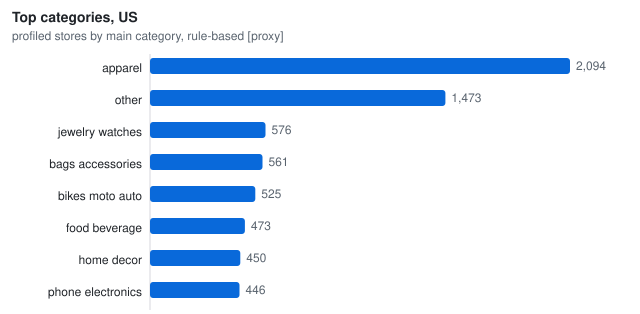
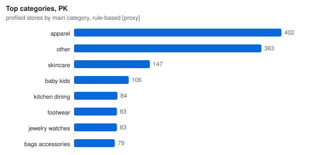
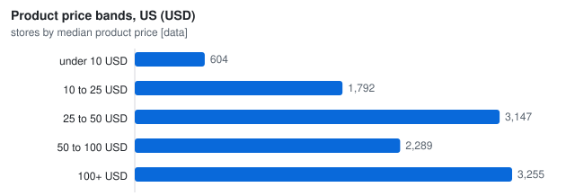
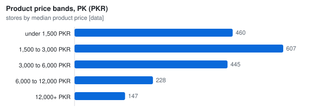
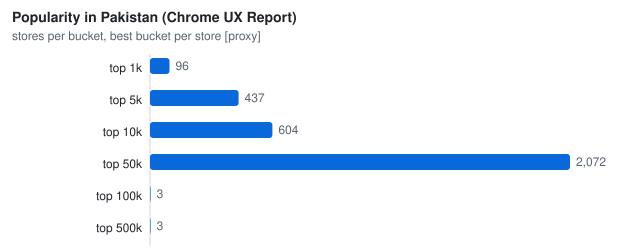
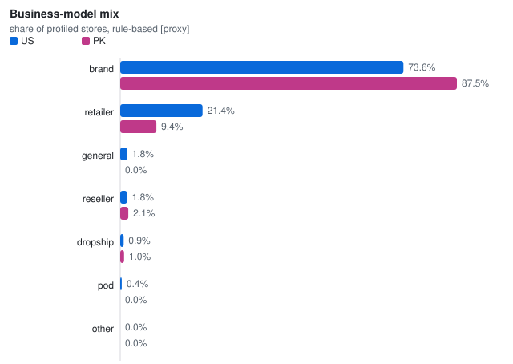
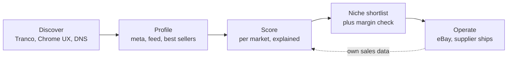
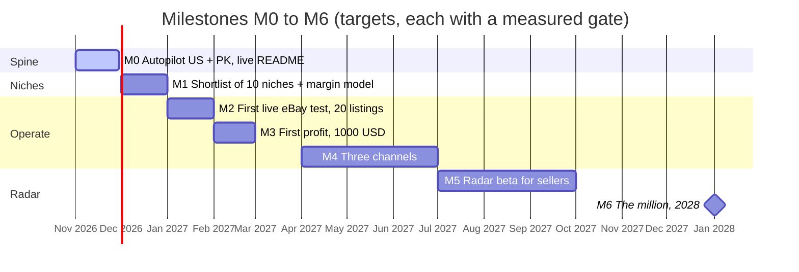

<div align="center">

# Shopify store radar for zero-inventory commerce

**We watch the winning stores, learn what sells and at what price, then list better than the incumbents. The supplier ships, we hold no stock.**

[](https://github.com/usman9114/drop-shipping-/actions/workflows/ci.yml)
[](https://github.com/usman9114/drop-shipping-/actions/workflows/autopilot.yml)


[At a glance](#at-a-glance) · [Charts](#charts) · [Pipeline](#how-it-works) · [Roadmap](#roadmap) · [Method](#method-and-caveats) · [Project map](#project-map)

</div>

> [!IMPORTANT]
> Every number here is an **aggregate** and is tagged `[data]` (observed), `[proxy]` (indirect signal) or `[unknown]`. No store, shop or product is named in this public page.

## At a glance

| Per market | US | PK |
|---|--:|--:|
| Stores found | 11,538 | 3,217 |
| Scored (profiled) | 11,141 | 1,888 |
| With popularity data (Chrome UX) | 0 | 3,215 |
| Categories seen | 36 | 35 |
| Median product price | 50 USD | 2,600 PKR |
| Own brand [proxy] | 73.6% | 87.5% |
| Reseller or retailer [proxy] | 23.2% | 11.5% |
| Dropship [proxy] | 0.9% | 1.0% |
| Best-seller lists found | 0 | 35 |

> [!NOTE]
> Counts are `[data]`. Business model is a rule-based `[proxy]` (hand-checked, see below). Prices are the median of each store's median product price, in local currency.

## Charts

<p align="center">


</p>
<p align="center">


</p>
<p align="center">


</p>

## How it works



## Roadmap



- [x] US store radar on autopilot
- [x] Pakistan radar: Chrome UX popularity and best-seller collections
- [ ] Live README refreshed by CI (first run pending)
- [ ] M0 gate: daily runs green 7 days in a row
- [ ] M1: shortlist of 10 niches with a margin model
- [ ] M2: first live eBay test (20 listings, 2 niches)
- [ ] M3 to M6: profit, three channels, radar beta, the million

## Method and caveats

<details><summary><b>How the ranking works</b></summary>

Each profiled Pakistani store gets four parts from 0 to 1, combined with these weights (one place in code: `market_rank.WEIGHTS`).

| Part | Weight | What it measures |
|---|--:|---|
| pk popularity | 0.35 | popularity inside Pakistan, Chrome UX bucket [proxy] |
| growth | 0.25 | percentile of rank growth over a year [proxy] |
| global rank | 0.20 | inverse percentile of the global Tranco rank [proxy] |
| rhythm | 0.20 | percentile of products added in the last 90 days [data] |

Chrome UX bucket scores: 1k = 1.0 · 5k = 0.8 · 10k = 0.6 · 50k = 0.4 · 100k = 0.2 · 500k = 0.0.
Why: the US score weights traffic 0.45, growth 0.20 and rhythm 0.20; Pakistan splits traffic between local popularity and the global list because small local stores are invisible to the global list.

**What would change the order:** fast rank growth lifts a store past a busier, flat one; a store that stops adding products drops; stores outside the global top 1M can rank high on popularity but never earn growth points.

> [!WARNING]
> Popularity and rank measure visits, not sales. Revenue, orders, ad spend and margin are `[unknown]` for every store.

</details>

<details><summary><b>How good are the rules</b></summary>

| Check | Result | Note |
|---|--:|---|
| Business model, Pakistan, 40 hand-checked stores | 36 of 40 (90%) | in-sample; 31 of 32 when high confidence; [decision 0019](docs/decisions/0019-pakistan-market-store-ranking.md) |
| Same rules before tuning | 25 of 40 (62%) | US rules as they were; [decision 0019](docs/decisions/0019-pakistan-market-store-ranking.md) |
| Free-model second opinion | 34 of 40 (85%) | disagreement is a review flag; [decision 0019](docs/decisions/0019-pakistan-market-store-ranking.md) |
| Best-seller collection picker, held-out | 19 of 20 (95%) | 87% in-sample; [decision 0021](docs/decisions/0021-robots-wildcards-and-best-seller-collection.md) |
| Chrome UX coverage of PKR stores | 909 of 911 | [decision 0020](docs/decisions/0020-crux-country-popularity.md) |

> [!NOTE]
> Held-out check of the business model for Pakistan is still due. Each error found becomes a test.

</details>

<details><summary><b>What we do not know</b></summary>

- Revenue, orders, conversion, ad spend: `[unknown]`. Public records do not show them.
- Supplier cost and margin per product: `[unknown]` until the margin model (M1).
- Demand on eBay: `[unknown]`. A Shopify store's success shows demand and method, not eBay demand. Only our own live test measures it.
- Social-only sellers (Instagram, WhatsApp) leave no trace on their own pages, so Pakistan is likely under-counted.

</details>

<details><summary><b>Data sources and terms</b></summary>

- Popularity by country: [Chrome UX Report](https://developer.chrome.com/docs/crux), via [BigQuery](https://cloud.google.com/bigquery/public-data), licence [CC BY 4.0](https://creativecommons.org/licenses/by/4.0/).
- Global rank: [Tranco list](https://tranco-list.eu).
- Store pages: public machine records only (`/meta.json`, product feed, `robots.txt` respected). No data is ingested before its terms are read and recorded.
- Supplier: [CJ Dropshipping](https://cjdropshipping.com) product images and catalogue. Marketplace: [eBay](https://www.ebay.com).

</details>

<details><summary><b>Run it yourself</b></summary>

```bash
make setup                       # install hooks and tools
make test                        # run the test suite
python -m scout.market_rank --market pk --top 40
python scripts/readme_build.py   # rebuild this page
```

</details>

## Project map

| Folder | What lives there |
|---|---|
| [`docs/plan/`](docs/plan) | goals, exit criteria, north star, dev loop |
| [`docs/decisions/`](docs/decisions) | every owner decision and terms record |
| [`docs/research/`](docs/research) | sourced research reports |
| [`scout/`](scout) | pipeline: discovery, profiling, ranking, free-model router |
| [`ui/`](ui) | the private explorer; its data files are gitignored and published only to the owner's private page |

<sub>Generated by `scripts/readme_build.py` on 2026-11-25 UTC from the private lake; numbers are aggregates.</sub>
