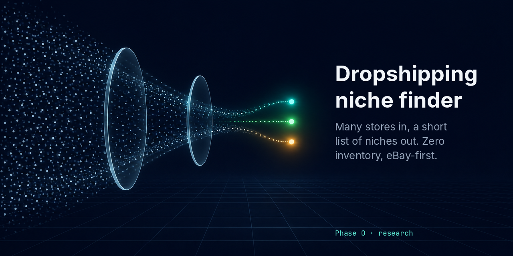
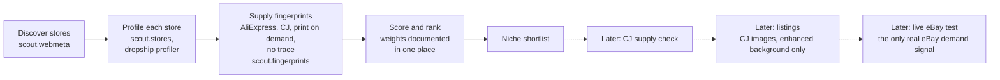

<p align="center"></p>

# drop-shipping-

Proof of concept: is **eBay dropshipping** (and similar marketplaces) feasible? Pick niches with proven demand, make better listings from CJ Dropshipping's own product images and accurate descriptions, and fulfil through CJ with **zero inventory**: every order is bought from the supplier after the customer pays and shipped straight to the buyer.

Verdict, thesis and the phased plan with kill criteria: [`docs/research/00-summary.md`](docs/research/00-summary.md).

## Where we are

**Phase 0, release R1 "Niche Finder"**: find the best online stores, see what they do and what supplies them, and end with a **niche shortlist** (not a single product). Goal, deliverables, exit criteria and scope: [`docs/plan/phase-niche-finder-r1.md`](docs/plan/phase-niche-finder-r1.md). Flow: [`docs/plan/step1-flow.md`](docs/plan/step1-flow.md). Sourcing, listings and the live eBay test come in later phases.



A Shopify store's success shows demand and method, not eBay demand. Only our own live test measures eBay. Every number in the reports is tagged `[data]` (observed), `[proxy]` (indirect signal) or `[unknown]`.

## Where to look

| What | Where |
|---|---|
| Rules and working principles | [`CLAUDE.md`](CLAUDE.md) |
| Research reports (eBay policy, unit economics, suppliers, tooling, legal, images) | [`docs/research/`](docs/research) |
| Phase plans | [`docs/plan/`](docs/plan) |
| Decisions, with candidates and reasons | [`docs/decisions/`](docs/decisions) |
| Latest hand-off state | [`docs/handoff/session-state.md`](docs/handoff/session-state.md) |

## Run

```bash
make setup      # once per clone: pre-commit hooks, graphify hooks
make lint
make niches     # R1: scan, profile, score, shortlist, supply check (about 3 h)
```

API keys go in `.env` (gitignored); see `CLAUDE.md` for the rules on secrets, data terms and images.

## Visual assets

The banner illustration was generated from a written brief (`docs/assets/briefs/`, with the references it drew on); its sidecar `docs/assets/hero-art.png.json` records the prompt. Text is set in real type by `docs/assets/tools/compose_banner.py`. `docs/assets/social-preview.png` (1280x640) is for the repository's social preview. These are documentation images only: listing images always come from CJ's own product photos, with only the surroundings enhanced.
