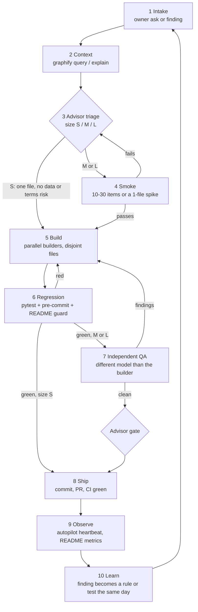

# Development loop: how agents build this project

> 2026-11-25. Owner: "make sure it's an iterative loop architecture ... optimise the token cost ... speed and agility ... parallel agents where possible, quick smoke tests before developing anything, consult the advisor (advisor decides if it needs further verification), small features not worth going through can be skipped ... all agents' context is managed with graphify." The goal it serves: `docs/plan/north-star.md`.

## The loop

## Triage sizes (the advisor decides, in one line)

| Size | Examples | Smoke | QA | Advisor gate |
|---|---|---|---|---|
| **S** | a label, a doc fix, a flag, a one-function change with an obvious test | skip | skip | skip: regression is enough |
| **M** | a new job, a new rule, a new README section, a workflow change | yes | one QA agent (Haiku or Sonnet) | yes, reads the QA report only |
| **L** | a new data source, a scoring change, anything touching terms, money, secrets or public output | yes, plus terms read | QA agent + second-opinion model | yes, reads diff and report |

Anything touching **public output** (README, Actions logs) or **secrets** is never S.

## Who runs each step

| Step | Agent | Why |
|---|---|---|
| Triage, gate, plan | Opus (advisor) | judgement; few tokens |
| Context | `graphify query/explain/path` | scoped subgraph instead of reading files |
| Smoke, research, cheap QA | Haiku subagents | fast, cheap |
| Build, deep QA | Sonnet subagents | code quality |
| Bulk labels, second opinions | GLM Flash / OpenRouter free via `scout.llm` | free |

## Token-cost rules

1. **Graph first.** Every agent brief contains: "run `graphify query \"<question>\"` before any grep or file read; read only the lines the graph names." After code changes: `graphify update .`.
2. **Briefs, not history.** Subagents get a self-contained brief (files, done-criteria, rules); they never get the whole conversation.
3. **Parallel on disjoint files.** Builders run at the same time only when their file sets do not overlap; the advisor commits.
4. **Cheapest model that passes.** Haiku for search and smoke, Sonnet for code, GLM for bulk; Opus only plans and reviews.
5. **Reports are short.** A subagent returns: what changed (files), test result (counts), open issues. No file dumps.
6. **Hand off, don't compact** (CLAUDE.md principle 14): after a big phase, update `docs/handoff/session-state.md`, commit, start fresh.

## Quality gates in the repo

| Gate | Where | Fails when |
|---|---|---|
| Unit + regression tests | `pytest` in `ci.yml` (Python 3.9 and 3.12) | any test fails |
| Lint, hygiene, secrets | `pre-commit` (ruff, detect-secrets, no-AI-attribution) | any hook fails |
| Public-output guard | `tests/test_readme.py`, `tests/test_autopilot.py` | README or logs contain a store domain, a secret or row-level data |
| Pipeline health | `autopilot health` every 6 h | a job missed its window or errors > 10% |
| Independent QA | QA agent report in the PR | an important finding is open |

## The loop for data (runtime, no Claude)

`autopilot daily` (GitHub Actions, 04:23 UTC): pull lake → US jobs → Pakistan jobs → build → README aggregates → push lake → commit README. Claude is not in this loop; findings from sessions become rules and tests that the loop runs (`docs/plan/autopilot.md`).
