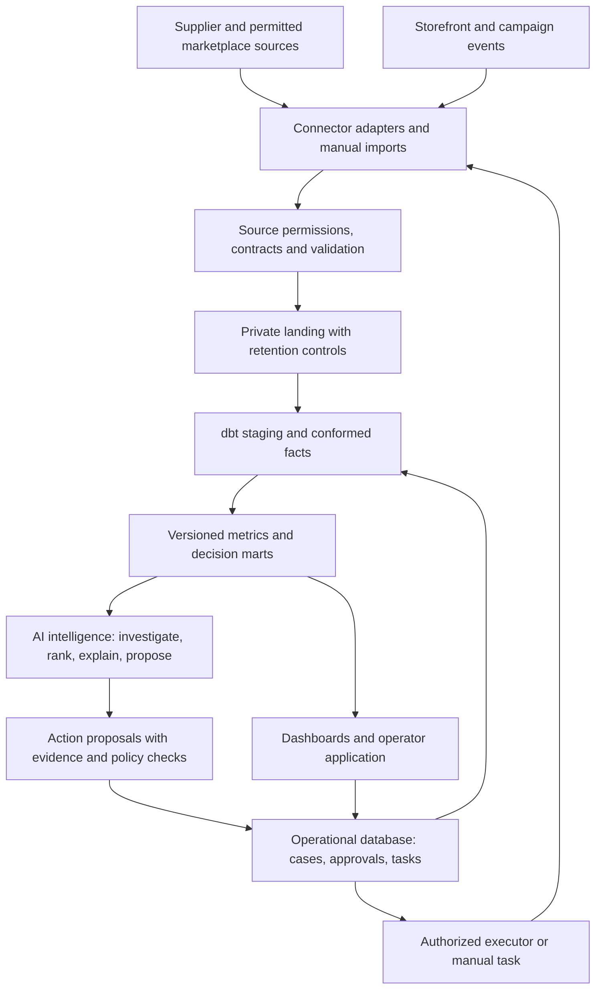

# End-to-end commerce platform: data, analytics and intelligence

Status: **proposal**, 2026-11-04. Planning only; no new services, credentials,
spending, data permissions or channel operations are enabled by this document.
Baseline reviewed: `92ec54a`. Keep accepted decisions unchanged; approve explicit
follow-up decisions where this proposal changes implementation or scope.

**Objective:** operate product discovery, feasibility, channel launch, marketing,
fulfillment and profitability as one measurable decision loop. AI leads analysis,
planning and investigation through an intelligence layer; versioned data and domain
services establish facts, calculate metrics and enforce business state transitions.

Evidence convention: current repository observations are [data]; official references
are [primary]; proposed architecture, targets and durations are [estimate].

## 1. Starting position and immediate decisions

[data] The project has CJ ingestion, a private working lake, DuckDB/dbt transformations,
supplier offer costing, rules, cached model classifications and image screening.
The baseline passes 84 Python tests. CI runs pytest and pre-commit; it does **not**
yet exercise the complete dbt DAG with synthetic fixtures.

[data] The exported pool has 268 products, 252 meeting the supply/cost screen;
177 of those still have review rules. All 245 demand-observation rows are blank.
The image cache has 31 checks, while the exported pool reflects an earlier build.
These counts describe research coverage, not products approved for sale.

Immediate decisions this platform must unblock:

1. Which available products have demand at the price our business needs?
2. Which can be sold and fulfilled with documented permissions and acceptable risk?
3. Which delivered orders retain contribution after acquisition, returns and effort?
4. Which operational changes improve those results without increasing cash exposure?

The existing niche-specific shortlist and the warehouse must converge on one
candidate/evidence contract and one margin implementation. Do not build competing
shortlists or apply trading-card rules to an unrelated supply-first catalog.

## 2. System boundaries



Three distinct responsibilities:

- **Analytics plane:** evidence, transformations, forecasts, metrics and reproducible
  decisions. Rebuildable outputs do not directly issue business commands.
- **Operational plane:** durable tasks, approvals, orders' internal workflow state,
  action attempts and reconciliation. Platform/supplier systems remain authoritative
  for their actual external order/payment/fulfillment states.
- **Intelligence plane:** hypotheses, investigation, recommendations, drafts and
  experiment proposals. It consumes controlled interfaces and cannot silently
  rewrite source facts, legal permissions, metric definitions or approval policy.

Build one modular application and a small job worker, not independent services for
every role. CLI/CSV first; add an authenticated operator UI when its workflows exist.
No Kafka, Kubernetes, vector database or autonomous agent framework is required for
this scope. Reassess only against a measured limitation and a concrete decision.

## 3. Stack and migration boundaries

All choices below beyond the existing stack are proposals [estimate].

| Concern | Initial implementation | Expansion trigger |
|---|---|---|
| Analytical storage | Existing private DuckDB file; serialized writer; published read-only snapshot | Measured concurrency, runtime or volume limit, not number of documents |
| Transformations | Existing dbt + SQL; shared Python domain evaluator | Retain contracts and tests when switching database adapters |
| Raw/evidence files | Private working directory with source-specific lifecycle; encrypted private object storage only for permitted retained data | Scheduled ingestion or persistence across sessions |
| Operational records | Versioned private inputs and durable task log for manual pilot | PostgreSQL before concurrent application writes, webhook intake or paid-operation execution |
| API/application | CLI now; proposed FastAPI service with typed request/response contracts | Multiple operators or channel callbacks require shared application state |
| Operator interface | Static reports/CSV now; proposed Streamlit internal UI over service endpoints | Regular research, approval and exception queues justify UI work |
| Business intelligence | SQL marts and exports now; compare Metabase versus Superset for shared BI later | Repeated management questions and permissions require a maintained BI layer |
| Scheduling | Explicit Make/CLI runs; GitHub Actions for CI | Private runner or scheduled worker after source rights and durable storage are ready |
| Background work | Idempotent jobs; proposed PostgreSQL-backed durable job/outbox tables | Adopt a maintained queue if retry/concurrency needs exceed simple job processing |
| Connectors | Existing CJ adapter; official platform APIs/SDKs where authorized; manual imports where required | Add a connector only when a product/operational decision requires it |
| Schema validation | Proposed Pydantic request/source contracts plus dbt contracts/tests | No separate schema registry service initially |
| AI routing | Existing router behind a controlled tool service; evaluate maintained router replacement separately | Reliability, spend control or provider coverage justifies migration |

Reuse assessment: DuckDB/dbt already have accepted decisions. FastAPI/Streamlit/
Pydantic are candidate application tools, not installed dependencies. Compare
license, maintenance, authentication, deployment and operating cost in an ADR
before implementing each new component. Keep business rules and metrics as domain
logic; reuse maintained libraries for authentication, API clients and job mechanics.

Postgres is initially an operational store when needed; it need not replace DuckDB
analytics. Avoid exposing a live analytical writer file directly to multiple app
processes. Publish completed snapshots or serve reads through its owning process.
DuckDB documents its native single-writer-process concurrency model [R1].

Do not promise SQL-only migration: current dbt Python/pandas models and DuckDB-specific
functions require adapter-specific implementation and reconciliation tests before
moving analytics to Postgres. Portability is a testable goal, not an assumption.

## 4. Source registry and application connectivity

Each connection has `connection_id`, legal-entity/account reference, environment
(sandbox/production), credential-secret reference, API version, scopes, permissions,
source owner, rate limit, health and last successful reconciliation. Credentials
never enter tables, prompts, logs, exports or Git.

Each source policy separately records `may_fetch`, `may_operate_transiently`,
`may_retain`, `may_analyze`, `may_send_to_model`, `may_publish`, allowed purpose,
terms URL/version, review date, reviewer, expiry, TTL and deletion procedure.
Rights to fetch are not rights to retain, train models or redistribute derivatives.
An unknown permission blocks that operation; where the current repository permits
transient operation, require an explicit bounded lifecycle before scheduling it.
No arbitrary default of indefinite retention for derived data or metadata.

| Connection | Reads / purpose | Writes / actions | Release gate |
|---|---|---|---|
| CJ | Approved catalog, variants, warehouse stock, freight and licensed assets | Ordering remains manual in the current eBay workflow | Account-specific terms; freshness and destination/quantity contract |
| Manual market research | Permitted operator observations and recorded conclusions | Append/correct observations through reviewed imports | Provenance, permitted use, comparable pack/unit and research date |
| eBay reference / own account | Category reference and own operations only after applicable terms/scopes review | Current project policy keeps supplier order forwarding, tracking and supplier-driven repricing/stock-sync manual | API-license review, production account and action-specific approval |
| eBay third-party market API | Disabled for pricing/statistics under current project policy | Disabled | Written permission and a superseding source decision |
| Shopify | Later: authorized own catalog, orders, transactions, refunds and supported events | Listing/inventory/fulfillment actions only after scoped approval and tested safeguards | Store authorization, appropriate scopes, verified webhooks and terms |
| Advertising | Authorized campaign spend, impressions, clicks and reported attribution | Budget/campaign changes proposed before execution | Account owner approval, budget policy and platform rules |
| Email / partnerships | Contact provenance, permission/suppression status, campaign results | Approved messages through authorized providers | Outreach purpose, consent/legal basis, suppression and content review |
| Bank / payouts / accounting | Private authorized exports or read-only feeds | No autonomous financial transfers | Verified account, reconciliation rules and strict access control |

A manual action is a supported adapter: create a work item, capture who completed it,
when and external reference, then reconcile. No scraper/browser bot is used to get
around missing APIs or platform restrictions.

Connector behavior: pagination/cursors, incremental checkpoint, bounded retry with
jitter, rate-limit handling, timeout, credential-expiry reporting, source version,
control totals and idempotency. Webhook endpoints validate the signature over the
raw body, durably accept an event, then process asynchronously. Deduplicate delivery
IDs and handle out-of-order updates; reconcile against authoritative reads.
Shopify explicitly recommends reconciliation alongside webhooks [R2]. Use its
supported GraphQL API and versioned contracts; bulk operations are candidates for
large backfills, with rate-limit handling for normal requests [R3, R4].

## 5. Data model: grains before tables

Use stable internal IDs, with source/account-scoped mapping tables. A supplier
product, variant, sellable pack and channel listing are different entities.
Do not join on titles, model labels or search phrases. Hashes help detect changes;
they are not a substitute for documented business identity.

| Domain / table | Grain | Important keys / history |
|---|---|---|
| `dim_product` | One canonical product concept | `product_id`; descriptions with provenance and validity |
| `dim_variant` | One physical specification/variant | `variant_id`, supplier variant mappings; material/size/color |
| `dim_sellable_unit` | One exact commercial pack or bundle | `sellable_unit_id`, component quantities, supplier fulfillment compatibility |
| `dim_listing` | One listing on one channel account | `(account_id, external_listing_id)`; listing versions and sellable-unit mapping |
| `fact_supplier_offer` | Variant × warehouse × quote observation | Source price currency, stock, timestamp, run; change history within rights |
| `fact_freight_quote` | Carrier/service × origin × destination zone × basket/quantity × quote | Currency, fees, handling, expiry; never treat one zip quote as national certainty |
| `fact_market_observation` | One researcher observation for one defined market/cohort/window | `observation_id`, source, method, geography, sample/quantity/condition, revision |
| `bridge_candidate_comparable` | Candidate × observation match | Match reason, unit conversion, reviewer, confidence and validity |
| `fact_compliance_evidence` | Candidate/asset × requirement × assessment | Evidence reference, rule version, assessor, expiry, status |
| `fact_evaluation` | Candidate × scenario × model version × input snapshot | Output metrics, evidence IDs, assumptions and decision state |
| `fact_order_line` | One external order line | Channel/account/order/line; ordered quantity, price and discounts |
| `fact_fulfillment_event` | One shipment/status event | Order allocation, tracking reference, occurrence and receipt times |
| `fact_financial_entry` | One signed charge, credit, payout allocation or adjustment | External transaction ID, amount/currency, order link, accounting category |
| `fact_return_case` | One return/refund/dispute case | Linked order lines and financial entries; reason/status/resolution |
| `fact_campaign_daily` | Account × campaign × creative × date × reporting version | Spend and native metrics; attribution definition/window |
| `fact_behavior_event` | One permitted storefront interaction | Event ID, anonymous/session IDs where allowed, event time, consent, source |
| `fact_experiment_assignment` | One eligible unit assigned to an experiment | Experiment/version, assignment time, unit type and treatment |
| `fact_support_work` | One support interaction/work record | Case/order, reason, duration, outcome; text/PII kept separately |
| `fact_cash_snapshot` | Entity/account/currency × snapshot time | Available, pending, held, committed and reserve amounts |
| `ops_action` / `ops_approval` | One proposed action / approval decision | Actor, policy version, evidence snapshot, expiry and idempotency key |

Store money as fixed-precision decimals or currency-aware minor units; never sum
currencies. Preserve transaction currency, functional reporting currency, FX rate,
rate date and source. Explicit allocation rules distribute order-level fees/discounts
and freight over order lines; rounding residuals must reconcile exactly.

Every evidence/fact row includes source/account, `run_id`, source record ID,
`occurred_at`/`observed_at`, `ingested_at`, schema version, evidence class and lineage.
Keep corrections distinct from what was known at decision time. Replays must support
both current-restated reporting and an as-known-at snapshot, within retention rights.

## 6. Pipeline, contracts and quality gates

Layers: `meta` → permitted `raw` → typed `stg` → conformed `core` → versioned
`enrich` → business `mart`. Operational data enters through explicit extracts/events;
AI output writes only to enrichment/proposal tables, never raw business facts.

Proposed envelope:

```json
{
  "schema_version": "1",
  "source_id": "MOCK-source",
  "connection_id": "MOCK-connection",
  "event_id": "MOCK-event",
  "source_record_id": "MOCK-record",
  "run_id": "MOCK-run",
  "observed_at": "2026-11-04T00:00:00Z",
  "ingested_at": "2026-11-04T00:01:00Z",
  "evidence_class": "mock",
  "policy_version": "MOCK-policy",
  "payload_ref": "private-object-reference",
  "content_hash": "MOCK-hash"
}
```

Ingestion: permission check → acquire → validate → quarantine invalid rows → land
permitted records → reconcile counts → checkpoint. After staging/core transforms,
run tests and publish a versioned mart snapshot atomically. Failed builds preserve
the last good snapshot, clearly marked stale; they never expose half-built results.

Required controls:

- Unique scoped source/event keys; deduplicate before aggregation.
- Contract/type/unit validation, finite prices, nonnegative quantities and explicit currencies.
- Referential integrity across candidate, listing, order and supplier mappings.
- Fetched = accepted + rejected + identified duplicates, with counts recorded.
- Freshness policies by use: research can tolerate older evidence; launch/order decisions
  require their own stricter stock/quote checks. Exact thresholds are source-specific configuration.
- Missing safety/image evidence is `NOT_ASSESSED`, never false/clean by default.
- Critical data failures block dependent promotion; expected missing demand stays visible.
- Backfills use checkpoints and overlap windows to catch late changes; delete/tombstone
  handling and source corrections are included. One run owns each write partition/window.
- Exports never overwrite researcher-entered evidence. Generated worklists and append-only
  observations have separate paths, stable IDs and revision histories.
- Retention/deletion propagates to caches, exports, backups and model-input stores as required.
  Git is only for code, rules, contracts, synthetic fixtures and explicitly cleared artifacts.

Publish dbt model documentation and lineage plus a catalog of owners, grain, units,
permissions and freshness. dbt contracts/tests and explicit source-freshness checks
provide a starting point [R5, R6]. Do not infer freshness from build success alone.

## 7. Metric layer and analytics products

One versioned SQL/domain definition per metric, reused by dashboards, API and AI.
Every response carries definition version, grain, currency, period, freshness and
coverage; unavailable metrics return missing with a reason, not zero.

| Mart / analytics product | Questions answered | Decision |
|---|---|---|
| Supply feasibility | Stock depth, quote coverage, required price, sensitivity to freight/ads/returns | Which products deserve demand research? |
| Demand and competition | Comparable sold evidence, quantity/condition match, price support and observation age | Which candidates have credible demand at the required price? |
| Launch readiness | Terms, compliance, images, sample tests, policies, mapping and cash gate completion | Which exact listing versions can be released? |
| Acquisition funnel | Impression → click → session → checkout → purchase where observable | Which offer/creative/channel needs an experiment? |
| Unit economics | Expected vs realized contribution by SKU/channel/cohort | Does each product retain money? |
| Supplier operations | Stockout cancellations, dispatch/delivery delays, damaged items, quote drift | Which offers need pausing or supplier follow-up? |
| Returns and customer care | Reasons, refunds, dispute loss, response workload and time | What is damaging margin and trust? |
| Cash and settlement | Payout holds, settlement differences, order-funding need and refund reserve | How many orders can safely be accepted? |
| Retention | Repeat purchase and realized contribution by customer cohort where permitted | Is retention worth investing in? |
| Experiment results | Assignment/exposure, conversion, contribution and guardrail effects | Continue, modify or stop a test? |
| Data/AI operations | Freshness, completeness, pipeline failures, inference cost and review accuracy | Can decisions be trusted today? |

Metric contract examples:

- **Net merchandise revenue:** item/charged-shipping revenue minus discounts and
  refunds, excluding tax collected for authorities. Document marketplace-specific mappings.
- **Realized contribution before marketing:** net revenue minus supplier goods,
  fulfillment/freight/duties, platform/payment fees and return/dispute costs, net of
  actual credits. No double-counted fee or refund entries.
- **Contribution after marketing:** preceding metric minus allocated acquisition
  spend. Report unresolved allocation separately. Show owner/support labor separately
  and in a second fully costed view, then fixed overhead and accounting profit.
- **Expected vs realized:** expected refund reserves support early decisions;
  realized refunds replace the relevant reserve rather than being charged twice.
  Always label open return windows and immature cohorts.
- **CAC:** attributed acquisition spend / newly acquired customers, with identity
  and attribution limitations. Cost per order is a separate metric. Zero acquisitions
  makes CAC undefined; do not display zero.
- **Conversion:** purchases / eligible sessions or clicks for the chosen source and
  window. eBay listing conversion and Shopify session conversion are different metrics.
- **ROAS:** attributed revenue / advertising spend; useful for acquisition diagnosis,
  not a substitute for contribution or cash profitability.
- **Sell-through:** preserve the source's definition/window; never silently substitute
  sold/(sold+active) for a platform metric. Do not confuse search interest with sales.

Reconcile order lines to order totals, transactions to marketplace settlements and
settlements to bank receipts, allowing explicit timing/FX/fee differences. Payout is
not revenue; revenue is not cash available. Unknown fees remain unresolved liabilities.

## 8. Conversion tracking, experiments and outreach

Shopify later: permitted events `product_view`, `add_to_cart`, `checkout_started`,
`purchase`, `refund`; schema versions, consent state and deduplication IDs. Server-side
orders/transactions are authoritative for financial outcomes; browser pixels provide
behavioral context and may be missing, duplicated or blocked.

eBay: use only authorized native reports/own-account sources after terms review.
Mark unavailable funnel stages as unavailable; do not manufacture sessions or identify
buyers across channels through guessed matches.

Use a campaign taxonomy: channel, account, campaign, ad set/group, creative, experiment,
landing page and UTM values where supported. Store native reported attribution and
our own explicitly defined first/last-touch views separately; never add attributed
conversions from different platforms together as unique sales. Preserve direct/unknown
traffic, consent gaps and reporting latency. Attribution is not proof of incrementality.

Experiments register hypothesis, primary metric, guardrails, assignment unit, eligibility,
exposure time, budget, minimum evidence and stopping rule before launch. Use randomization
where feasible; otherwise label observational comparisons and confounding. Low-volume
results are inconclusive when they cannot distinguish an effect, not automatically wins.

Outreach records contain approved contact source, purpose/permission, suppression,
message version, campaign, response and cost. Separate marketing consent from a buyer's
service contact. AI drafts messages; sending uses authorized campaigns and verified
suppression checks. Do not treat public contact details as blanket outreach permission.

## 9. AI-led intelligence with controlled execution

The lead assistant manages an evidence-backed work queue: identify missing evidence,
choose the next investigation, coordinate specialist tasks, explain tradeoffs, draft
experiments and recommend whether to launch, pause or stop. Specialist roles are logical
capabilities, not a requirement to deploy multiple autonomous services.

| Capability | Allowed intelligence work | Evidence / control |
|---|---|---|
| Research lead | Identify unmet buyer needs and candidate clusters | Permitted sources, dated citations; unverified demand stays unverified |
| Supply analyst | Explain quote changes, stock concentration and feasibility | Reads deterministic supply and sensitivity marts |
| Compliance assistant | Detect suspicious text/images and request evidence | Rule hits and model flags route to review; no autonomous legal clearance |
| Growth analyst | Diagnose funnel loss, propose creative/pricing experiments | Metric definitions, attribution caveats, spend constraints |
| Operations analyst | Prioritize delayed orders, refunds and supplier questions | Authoritative status plus freshness; no inferred fulfillment success |
| Data engineer assistant | Diagnose quality failures, propose code/model changes | Synthetic tests, reviewed PRs, no production schema edits by prompt |
| Business lead | Recommend product/channel allocation and scale/stop | Contribution, cash, compliance, capacity and uncertainty together |

Expose a narrow tool/API contract: `get_candidate`, `get_evidence`, `get_metric`,
`get_data_health`, `run_saved_analysis`, `create_research_task`, `draft_listing`,
`propose_experiment`, `propose_action`. Read-only SQL, if supported, uses a restricted
role, curated schemas, row/time budgets and query audit; raw sensitive tables are not
available just because SQL is read-only.

Every model result records input snapshot/hash, source references, model/provider,
prompt/version, timestamp, structured output, uncertainty, validation result, token/
cost usage and reviewer disposition. Cache keys include model/prompt/schema versions,
not merely product title. Refresh stale facts; reproducible builds read approved cache
versions instead of silently rerunning models.

External descriptions, images and retrieved documents are untrusted data: instructions
inside them cannot change tools, permissions or system policy. Send only permitted,
minimum necessary content to providers; redact identity/customer fields and restrict
local-file/URL access. Separate model-output content from executable commands.

Evaluate intelligence on a held-out synthetic/approved set and sampled human review:
classification accuracy by class, missed risky products, false alarms, evidence citation
correctness, unsupported claims, malformed outputs, latency and cost per accepted task.
Model-reported confidence alone is not calibrated confidence. Timeouts and provider
failures produce abstention/retry tasks, not fabricated results or silent paid fallback.

## 10. Application workflows and authority

Candidate lifecycle:
`DISCOVERED → SUPPLY_SCREENED → DEMAND_SUPPORTED → COMPLIANCE_REVIEWED →
SAMPLE_VERIFIED → READY_FOR_APPROVAL → PILOT_LIVE → SCALE / PAUSE / RETIRE`.
`BLOCKED` and `REJECTED` retain explicit reason/evidence. Stale evidence can invalidate
readiness and return the candidate to review. Store separate supply/demand/compliance/
image statuses so a financial pass never collapses all gates into one “viable” boolean.

Internal action lifecycle:
`PROPOSED → VALIDATED → APPROVED → QUEUED → EXECUTING → CONFIRMED`, with `FAILED`,
`UNKNOWN_OUTCOME`, `CANCELLED` and `EXPIRED` states. A provider timeout after submission
requires reconciliation before retrying a purchase or other non-idempotent action.
Manual actions follow the same audit states with an operator completion reference.

Before executing a permitted action, recheck current scope, evidence freshness, entity/
account mapping, approved payload hash, quantity/budget limits and approval expiry.
Atomic action/outbox persistence avoids a committed task without a queued job.
Use idempotency keys where the provider supports them and reconciliation otherwise.
No “exactly once” claim across external systems; target an effectively-once business result.

Authority policy [estimate]: automate deterministic reads, builds and eligible internal
research tasks within recorded permissions. Public listing changes, spending, external
outreach and financial/fulfillment actions require the relevant owner authorization and
channel permission; scoped recurring approvals can be recorded where appropriate.
The current manual eBay operations policy remains in force.

Operator UI modules when justified: research queue, candidate evidence panel, scenario
comparison, launch checklist, listing drafts, order exceptions, growth experiments,
financial reconciliation and data-health dashboard. Each number links to evidence;
each action shows expected effects, cost and required authority before execution.

## 11. Reliability, security and operations

- Separate development/test/production, accounts and secrets. Test fixtures are MOCK;
  production customer/supplier data never enters public CI artifacts or Git history.
- Role separation: connector reader, pipeline writer, analyst reader, operator and approver.
  Secret rotation, least privilege, access review and private audit logs have named owners.
- Bounded source/model retries, dead-letter/quarantine queues and resumable jobs. Alert
  on stale stock, broken contracts, failed reconciliation and exhausted budgets.
- Proposed initial targets [estimate]: critical workflow incidents acknowledged within
  one working hour; nightly backup of permitted durable data; restore drill before live
  operations. Final recovery targets must match actual staffing and order volume.
- Checkpoint external events durably before acknowledging them. Recovery replays them
  without duplicate business actions. Restoration tests include approvals and action ledger.
- Backups honor deletion/retention obligations. Expired source content is not retained
  indefinitely merely to make historical rebuilds convenient.
- Track storage, connector requests, job runtime, model tokens and cost by source/task.
  Enforce caps and report costs per screened candidate and per completed order.
- Synthetic end-to-end CI: landing → staging → marts → API response → approved/manual
  task → fake provider result → order/refund/settlement reconciliation.

Required release tests: duplicate/out-of-order events, partial refunds, multi-line orders,
pack mapping, missing currency, FX/rounding, stale stock, bad image result, revoked source
permission, approval expiry, timed-out external action, missed webhook and recovery.
Golden tests cover decision/report semantics. No real customer or API data in fixtures.

## 12. Delivery plan and engineering ownership

Effort ranges are estimates for focused engineering time, excluding account, supplier,
legal and owner research delays. Milestones are gated by evidence, not calendar promises.
Roles below assign responsibilities; one person may hold several roles.

| Milestone | Scope | Owner role | Exit gate | Estimate |
|---|---|---|---|---|
| M0: Protect current work | Non-destructive exports, separate observations, unknown image state, updated handoff and one shortlist contract | Data engineer + application engineer | Re-export preserves filled research; stale/unknown never appears cleared | 1–2 days |
| M1: Evidence platform | Source/connection registry, canonical SKU/unit mapping, typed observation import, provenance, full dbt fixture CI | Data engineer | One candidate reproducible from fixture/approved evidence; replay idempotent | 3–5 days |
| M2: Decision analytics | Demand matching, scenario evaluator, evidence coverage and launch readiness marts, metric definitions | Analytics engineer + business lead | Small candidate group supported by real permitted demand and costs, or explicit stop | 3–5 days plus research |
| M3: Operational foundation | Private durable workflow store when triggered, typed API, approvals, outbox/manual task queue, accounting mappings | Application engineer + operations owner | Rehearsed order-to-refund workflow with recovery and reconciliation | 5–8 days |
| M4: Measured eBay pilot | Verified listings, authorized native reports/imports, actual costs, support time and cash views | Operations + growth analyst | A capped pilot with reconciled orders and visible open return exposure | 3–5 days setup plus observation |
| M5: Intelligence workbench | Curated tools, evidence-cited daily brief, proposals, versioned model caches and evaluation | Intelligence engineer + business lead | Recommendations trace to metrics; unsafe/unsupported actions blocked | 3–5 days; may begin after M2 |
| M6: Shopify/growth expansion | Authorized Shopify adapter, event ingestion, attribution, campaign/outreach tracking and experiments | Application + analytics + growth | Proven demand, viable acquisition hypothesis and funded channel budget | 5–10 days plus channel setup |

No need to finish M5/M6 before the first properly controlled pilot. Analytical depth
comes from reliable contracts and accounting, not installing the entire target stack.
A product fail can stop commercial expansion while reusable data tooling remains useful.

First implementation backlog, in dependency order:

1. `DE-01` Separate generated worklist from researcher observations; stable IDs and revision import.
2. `DE-02` Make image state explicit; refresh exports from a declared snapshot.
3. `DE-03` Define source permissions, retention and connection registry, including sandbox/production.
4. `DE-04` Canonical product/variant/sellable-unit mappings and approved comparable joins.
5. `DE-05` Add full synthetic dbt DAG CI and control-total/reconciliation tests.
6. `AE-01` Consolidate supply screen + offline shortlist into one candidate/evaluation contract.
7. `AE-02` Import permitted demand observations and publish evidence-coverage mart.
8. `AE-03` Version economic scenarios, applicable fee/FX assumptions and margin sensitivities.
9. `AE-04` Publish candidate and launch-readiness views with separate gate statuses.
10. `APP-01` Define operational actions/manual tasks, approval policy and external references.
11. `APP-02` Add durable storage/API only when concurrent workflows or callbacks begin.
12. `AE-05` Implement order-line/transaction/refund/settlement reconciliation and cohort economics.
13. `AI-01` Add curated analysis tools and structured evidence-cited recommendation outputs.
14. `AI-02` Evaluate model quality, abstention, timeouts, cost and instruction-injection resistance.
15. `GROWTH-01` Instrument supported conversion stages and version experiment definitions.
16. `CHANNEL-01` Add Shopify only after the expansion gate; test signed webhook + replay + reconciliation.

## 13. Acceptance criteria and decisions to record

The platform is ready for its first commercial pilot only when:

- Every candidate/result identifies its evidence, scenario and unresolved gates.
- Source rights, ownership and retention are recorded for each enabled operation.
- A filled research sheet survives export/rebuild; source changes do not erase human evidence.
- The complete analytical DAG runs in CI on synthetic data; totals and freshness are checked.
- One selling unit maps unambiguously to channel listing, supplier variant and fulfillment quantity.
- An order, partial refund and payout reconcile without duplicating revenue/cost or mixing currencies.
- An AI recommendation is reproducible as evidence plus structured reasoning, and cannot execute
  an unauthorized external action. Model failure does not become a successful business state.
- Operator can pause a product, reconcile uncertain actions and recover the permitted durable records.
- Budget, approved business accounts, supplier arrangements and launch authority are established.

Next ADRs: observation/candidate contract; source-permission model; application/store
boundary; metrics/accounting policy; action authority; model/tool access; channel scopes.
Do not silently revise decisions 0001–0006. This proposal flags outdated plans that
still imply raw data in Git, automated eBay market pricing, indefinite retention or
production Postgres already being active; reconcile those through explicit follow-ups.

## Official implementation references

[R1] DuckDB concurrency: https://duckdb.org/docs/stable/connect/concurrency.html

[R2] Shopify webhooks and reconciliation: https://shopify.dev/docs/apps/build/webhooks

[R3] Shopify GraphQL API rate limits: https://shopify.dev/docs/apps/build/apis/graphql-admin/rate-limits

[R4] Shopify bulk queries: https://shopify.dev/docs/apps/build/apis/graphql-admin/bulk-operations/queries

[R5] dbt data tests: https://docs.getdbt.com/docs/build/data-tests?version=1.12

[R6] dbt source command/freshness: https://docs.getdbt.com/reference/commands/source?version=1.12

Repository sources: `docs/decisions/0006-duckdb-warehouse.md`,
`docs/handoff/session-state.md`, `docs/plan/operating-plan.md`, current `warehouse/`,
`scout/`, `.github/workflows/ci.yml` and derived shortlist/research exports.
