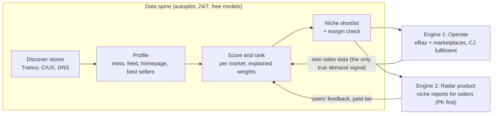

# North star: from store radar to a zero-inventory commerce engine

> 2026-11-25. Owner: "make a high level ambitious plan ... be very optimistic like a million dollar idea ... if something seems impossible we can revise." Written by the advisor (Opus). This is the **ambition**; `docs/plan/phase-*.md` stays the **contract** for the current phase (CLAUDE.md principle 1). Every milestone has a number to hit and a kill criterion, so optimism never turns into spending on hope.

## The idea in one paragraph

Most sellers guess. We **watch the winners** (thousands of Shopify stores in the US and Pakistan, then more markets), learn from public machine records what sells, at which price and through which channel, and turn it into **niche shortlists with a margin check**. Then we **list better than the incumbents** (CJ's own images with AI-enhanced surroundings, accurate structured descriptions) on eBay and other marketplaces, with **zero inventory**: the customer pays, CJ ships. The radar is the moat: it gets better every day on autopilot, at near-zero cost, and the same engine can be sold to other sellers once it is proven on our own money.

## Three engines, one data spine

1. **Operate** (revenue now): our own zero-inventory listings across eBay US, then eBay UK/DE, Daraz (Pakistan) and Shopify. Our own sales are the only real demand data; they feed back into the ranking.
2. **Radar** (revenue later): sell aggregated, terms-clean niche intelligence to sellers. Pakistan first: a fast-growing Shopify scene with no local intelligence tool. Only aggregates and sources whose terms allow it (terms gate).
3. **Spine** (cost, not revenue): the autopilot that discovers, profiles and ranks stores every day. Already running for the US; Pakistan added in this release.

## Milestones (optimistic dates, honest gates)

| # | Milestone | Target | Gate to pass (measured) | Kill or revise if |
|---|---|---|---|---|
| M0 | **Spine for US + PK on autopilot; README is the live dashboard** | 2026-11 | daily runs green 7 days in a row; README refreshed by CI; full regression + QA pass | runs fail 3 days running with no fix |
| M1 | Niche shortlist (10 niches) + margin model, both markets | 2026-12 | each niche: demand evidence `[proxy]`, CJ supply match, modelled margin ≥ 15% after fees | fewer than 3 niches pass the margin bar |
| M2 | First live eBay test: 20 listings, 2 niches | 2027-01 | listings live, compliant (compliance officer sign-off), first sale | 0 sales in 30 days on 20 listings: revise niche method |
| M3 | First profit | 2027-02 | $1,000 realized profit `[data]`, defect rate under eBay limits | realized margin under 10% for 60 days |
| M4 | Three channels | 2027-Q2 | eBay US + one more eBay site + Daraz or Shopify; $10k/month GMV | one channel carries > 90% of profit for 3 months |
| M5 | Radar beta | 2027-Q3 | 100 sellers on a free tier; 10 paying; terms review signed off | terms forbid the data we need: stay internal |
| M6 | **The million** | 2028 | $1M yearly GMV across channels, or $1M ARR-equivalent from GMV + radar | revise at each quarterly review |

M0 is the only milestone in scope now. M1 onwards wait for the owner's go (principle 1, principle 7: no spend without asking).

## What makes it possible (and what is already built)

| Capability | Status 2026-11-25 |
|---|---|
| US store radar: 11,500+ stores fingerprinted, daily autopilot on GitHub Actions + private Supabase lake | built (decisions 0016, 0017) |
| Pakistan radar: 3,217 PKR stores, 1,797 scored, CrUX popularity, best-seller collections | built this release (0019 to 0021) |
| Validated rules: business model 90% (in-sample), best-seller picker 95% held-out | built, held-out check for PK model due |
| Free model workforce (GLM Flash ×8, OpenRouter free lane 900/day) | built (`scout.llm`) |
| CJ client, image pipeline rules, compliance agent | partly built; Phase 1 |
| eBay listing + order loop (manual where License 9.6 requires) | not started; Phase 2 |

## The agent team that builds it

| Role | Model | Does |
|---|---|---|
| Advisor | Opus | plans, triages size, reviews, decides gates; never bulk work |
| Builders | Sonnet (subagents) | write code and tests on disjoint files, in parallel |
| Scouts | Haiku (subagents) | web research one topic each, smoke checks, cheap QA passes |
| Bulk workers | Z.ai GLM Flash, OpenRouter free | classification, extraction, second opinions, in the runtime loop |
| Context | graphify knowledge graph | every agent asks the graph first, reads only the lines it names |

How they work together: `docs/plan/dev-loop.md`.

## Risks we accept, risks we do not

- **Accept:** proxies are not sales; we label them and test with real listings early (M2) instead of polishing the radar forever.
- **Do not accept:** breaking a site's terms, holding stock, fabricated images, publishing store-level data the terms do not allow, spending without the owner's yes. The public README shows **aggregates only**; named stores stay in the owner's private page.

## What would change this plan

- M2 shows eBay buyers ignore our niches: put weight on Daraz/Shopify and the radar product.
- Empire Flippers calibration (`docs/plan/empire-flippers-calibration.md`) shows traffic does not track profit: drop rank from the score and lean on margin and business model.
- A market (Pakistan) shows strong own-brand dominance: use it to learn categories, not to copy stores.
