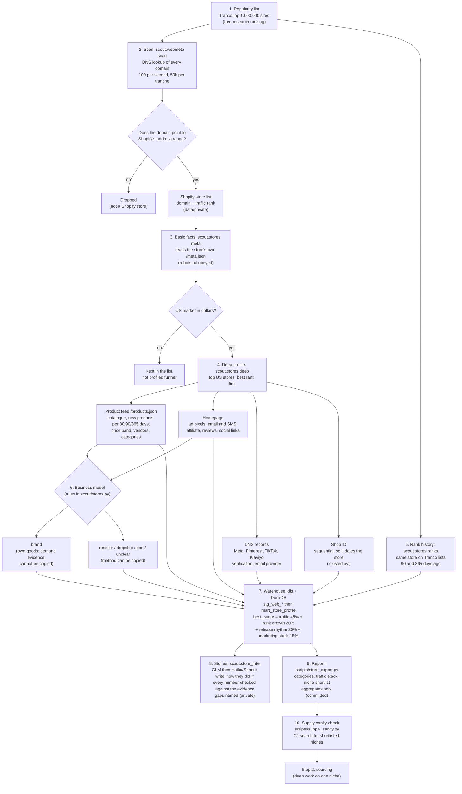

# Step 1 flow: how we find the best online stores and what they do

> 2026-11-04. Plain-language map of what `make stores` does, in the order it runs. Method and terms are in `docs/decisions/0009-best-store-discovery.md`. Raw store data stays in `data/private/`; only aggregates are committed.

## Diagram

## How it works, step by step

1. **Popularity list.** We download the Tranco list, a free ranking of the 1 million most visited websites. It stands in for the myip.ms list, which we may not scrape (its terms forbid it).
2. **Scan.** For each domain we ask Google's public DNS for its address. Shopify stores share one address range (23.227.38.0/24). We check all 1 million, 50,000 at a time, at a polite 100 lookups per second. The scan can be stopped and resumed, and every tranche records its own counts so coverage can be audited. Only Shopify hits are kept.
3. **Basic facts.** For each Shopify store we read its own public `/meta.json` after checking `robots.txt`. We keep country, currency, number of published products and collections, whether it ships to the US, and the shop ID. We drop city and description.
4. **Deep profile.** For US stores that sell in dollars, best traffic rank first, we read:
   - the product feed (up to 4 pages plus the last page): how many products were added in the last 30, 90 and 365 days, the price band, vendors, discount share, and categories from our rules. We keep counts only, no product text or images;
   - the homepage: ad pixels (Meta, TikTok, Google, Pinterest, Snap, Reddit, Microsoft), email and SMS tools, affiliate and influencer apps, review and loyalty apps, social links;
   - DNS records: platform verifications and email providers;
   - the shop ID: shop IDs rise over time, so the oldest product date among stores with a higher ID gives an "existed by" date.
5. **Rank history.** We look up the same stores on the Tranco lists from 90 and 365 days ago. A rank that falls (a smaller number) means growing traffic.
6. **Brand or copyable?** Rules decide:
   - **brand**: the store's own name is the vendor on most products. Its success shows demand and marketing method, but a zero-inventory seller cannot copy it.
   - **reseller, dropship, print on demand, unclear**: the method can be copied.
   - Supplier traces win: AliExpress-style image IDs, dropship SKU patterns, or dropship vendor names mark a dropshipper.
7. **Score.** In the warehouse each store gets a `best_score`: traffic rank 45%, rank growth 20%, release rhythm 20%, marketing stack 15%. Each is a percentile among the profiled stores.
8. **Stories.** For each top store, `scout.store_intel` builds an evidence pack. GLM writes the "how they did it" story, with Haiku and Sonnet as the paid fallbacks. If the text contains any number not in the pack, it is rejected and a fixed template is used. Every story ends with what is unknown: revenue, ad spend, traffic split by channel, supplier cost.
9. **Report and shortlist.** `scripts/store_export.py` writes the committed report: which categories the best stores win with, how they get traffic, and a niche shortlist. Categories that are risky for a new seller (food, supplements, children's products, adult) are excluded by our rules, and any published label needs at least 3 stores.
10. **Supply sanity check.** Before going deep on any niche, `scripts/supply_sanity.py` searches CJ for the shortlisted product types to see whether supply plausibly exists at a cost that leaves room. This is a quick check, not sourcing. Sourcing is step 2.

## What this cannot tell us

Revenue and order volume, ad spend and which ads run, traffic split by channel, supplier and product cost. These stay named as gaps in every story. Shopify success also shows demand and method, not eBay demand.

## Rules that apply throughout

- robots.txt is read and obeyed for every store request, with a pause between requests to one store.
- No personal data. No scraping of sites whose terms forbid it (myip.ms is excluded for that reason).
- Raw store lists and rows stay in `data/private/` (gitignored). Only aggregates are committed.
- Models: GLM first, then Haiku or Sonnet via OpenRouter. Opus advises and does no bulk work.
